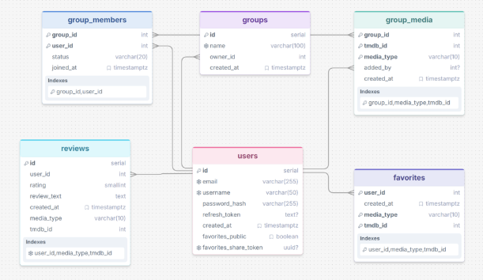

# TVT25KMO Group 7 Movie App

Movie App is a full-stack web application for discovering movies and TV shows, managing favorites, publishing reviews and sharing media with movie groups.

Movie and TV show information is retrieved from TMDB. User accounts, favorites, reviews, groups and memberships are stored in PostgreSQL.

This application was developed as a group project by second-year Information and Communications Technology students from Group 7 (TVT25KMO) at Oulu University of Applied Sciences.

## How the Application Works

Visitors can browse currently playing movies, search for movies and TV shows, view detailed media information, read reviews and browse available groups without creating an account.

Registered users can save favorites, share their favorite lists, publish reviews, create groups and request membership in existing groups. Accepted group members can view the group’s shared media and share movies or TV shows with the group.

Group owners can manage membership requests, remove members and delete their groups.

## Features

### Public Features

- Browse currently playing movies
- Search for movies and TV shows
- Filter and load additional search results
- View movie and TV show details
- Read reviews
- Browse available groups
- Open shared favorite lists
- Switch between light and dark themes

### Authenticated User Features

- Register and log in
- Restore the session with a refresh token
- View and manage favorites
- Create a shareable favorites link
- Publish movie and TV show reviews
- Create groups
- Request group membership
- View accepted group content
- Leave a group
- Share movies and TV shows with a group
- View profile information
- Delete the user account

### Group Owner Features

- View pending membership requests
- Approve or reject membership requests
- View current group members
- Remove members
- Delete the group

## Screenshots

### Search


### Movie and TV Show Details


### Group Page


Additional screenshots are available in the `Presentation/assets/screenshots/` directory.

## Design and Presentation

The original user interface was designed in Figma and adapted during implementation as the application features developed.

### Original UI Design


The project presentation is located in the `Presentation/` directory.

Start the presentation from the project root:

```bash
npx --yes serve Presentation -l 8080
```

Then open:

```text
http://localhost:8080
```

Stop the presentation server with `Ctrl+C`.

Additional instructions are available in [Presentation/README.md](Presentation/README.md).

## Technology Stack

| Area | Technology |
| --- | --- |
| Frontend | React and Vite |
| Backend | Node.js HTTP server |
| Database | PostgreSQL |
| Authentication | JWT, refresh tokens and bcrypt |
| External data | TMDB API |
| Containers | Docker and Docker Compose |
| Testing | Jest and Supertest |
| CI/CD | GitHub Actions |
| UI design | Figma |

## Architecture

```text
React frontend
    |
    | HTTP / JSON
    v
Node.js backend
    |
    +---- PostgreSQL
    |
    +---- TMDB API
```

The frontend communicates with the application backend through `/api` routes. TMDB credentials remain on the backend and are not exposed to the browser.

The backend is divided into routes, services and models:

- routes handle URLs, HTTP methods, authentication and responses
- services contain validation and business logic
- models execute parameterized PostgreSQL queries

## Database Model

The application data is stored in PostgreSQL. The database model connects users with favorites, reviews, groups, group memberships and shared group media.



## Project Structure

```text
.
├── Backend/
│   ├── auth/
│   ├── helpers/
│   ├── migrations/
│   ├── models/
│   ├── routes/
│   ├── services/
│   ├── tests/
│   ├── app.js
│   └── schema.sql
├── Frontend/
│   └── src/
│       ├── components/
│       ├── context/
│       ├── pages/
│       ├── app.jsx
│       └── styles.css
├── Presentation/
├── .github/workflows/
└── docker-compose.yml
```

## Requirements

Local development requires:

- Docker Desktop
- Git
- Node.js for running local utility and test commands
- a TMDB API read access token

## Local Setup

Clone the repository and enter the project directory:

```bash
git clone https://github.com/tvt25kmo-group7/tvt25kmo-group7-movie-app.git
cd tvt25kmo-group7-movie-app
```

Create a file named `Backend/.env` and add:

```dotenv
DB_NAME=moviedb
DB_USER=your_database_user
DB_PASSWORD=your_database_password
TMDB_API_TOKEN=your_tmdb_api_token
JWT_SECRET_KEY=your_first_random_secret
JWT_REFRESH_SECRET=your_second_random_secret
```

Generate the two JWT secrets separately:

```bash
node -e "console.log(require('node:crypto').randomBytes(32).toString('hex'))"
```

Run the command twice. Store the first value in `JWT_SECRET_KEY` and the second value in `JWT_REFRESH_SECRET`.

The values must be different. They are signing secrets, not user access tokens.

Never commit `Backend/.env` or expose its contents.

Start the application from the project root:

```bash
docker compose --env-file Backend/.env up -d --build
```

The local services are available at:

| Service | Address |
| --- | --- |
| Frontend | [http://localhost:5173](http://localhost:5173/) |
| Backend | [http://localhost:5000](http://localhost:5000/) |
| PostgreSQL | localhost:5433 |

Check the running containers:

```bash
docker compose --env-file Backend/.env ps
```

View backend logs:

```bash
docker logs movie-backend
```

View frontend logs:

```bash
docker logs movie-frontend
```

Stop the application:

```bash
docker compose --env-file Backend/.env down
```

Stopping or rebuilding the application containers does not delete the database volume.

## Database and Migrations

New databases are initialized using:

```text
Backend/schema.sql
```

Changes required by existing databases are stored in:

```text
Backend/migrations/
```

Migration files use idempotent SQL where possible so that they can be applied safely more than once.

The deployment workflow applies the schema and migration files to the deployed database.

PostgreSQL data is stored in the Docker volume:

```text
postgres_movie_data
```

Do not remove the volume unless you intentionally want to delete the local database data.

The main database entities include:

- users
- favorites
- reviews
- groups
- group memberships
- group media

## Authentication

Access tokens are valid for 15 minutes and are sent in the `Authorization` request header:

```http
Authorization: Bearer <access-token>
```

Refresh tokens are valid for seven days. They are stored in the database and sent to the browser in an HttpOnly cookie.

The frontend keeps the access token in React state. When the application starts, it attempts to restore the session through the refresh endpoint.

Protected frontend requests use a shared `authenticatedFetch` function. If a request returns HTTP 401, the frontend attempts to refresh the access token and retries the original request once.

## Main API Areas

The backend provides API routes for:

| Area | Route prefix |
| --- | --- |
| Users and authentication | `/api/users` |
| Movies and TV shows | `/api/movies` |
| Favorites | `/api/favorites` |
| Reviews | `/api/reviews` |
| Groups | `/api/groups` |

User identity and permissions are determined from verified JWT tokens. Clients cannot select another user by submitting a user ID in protected request bodies.

Detailed endpoint documentation, example payloads and validation notes are tracked in Jira as part of the project documentation.

## Testing

The backend test suite can be run with:

```bash
npm --prefix Backend test
```

Detailed test cases, validation notes and bug-fix tracking are documented in Jira rather than in this repository README.

## Deployment

The deployment workflow is defined in:

```text
.github/workflows/deploy.yml
```

Deployment runs after changes are merged or pushed to `main`.

The workflow requires the following GitHub Actions secrets:

| Secret | Purpose |
| --- | --- |
| `SERVER_HOST` | Ubuntu server public IP address |
| `SSH_PRIVATE_KEY` | Private SSH key used for deployment |
| `DB_NAME` | PostgreSQL database name |
| `DB_USER` | PostgreSQL user |
| `DB_PASSWORD` | PostgreSQL password |
| `TMDB_API_TOKEN` | TMDB API read access token |
| `JWT_SECRET_KEY` | Access-token signing secret |
| `JWT_REFRESH_SECRET` | Refresh-token signing secret |

`JWT_SECRET_KEY` and `JWT_REFRESH_SECRET` must contain different secure values.

The deployment rebuilds the application containers while preserving the PostgreSQL container and its data volume.

Secrets must be stored in GitHub Actions Secrets and must not be committed to the repository.

## Project Team

| Name | Role |
| --- | --- |
| Marianna Taavitsainen | Product Owner and Developer |
| Jani Rekinen | Scrum Master and Developer |
| Emil Koivunen | Developer |
| Joona Louhisalmi | Developer |

The developers shared responsibility for application design, implementation, testing, integration and documentation.