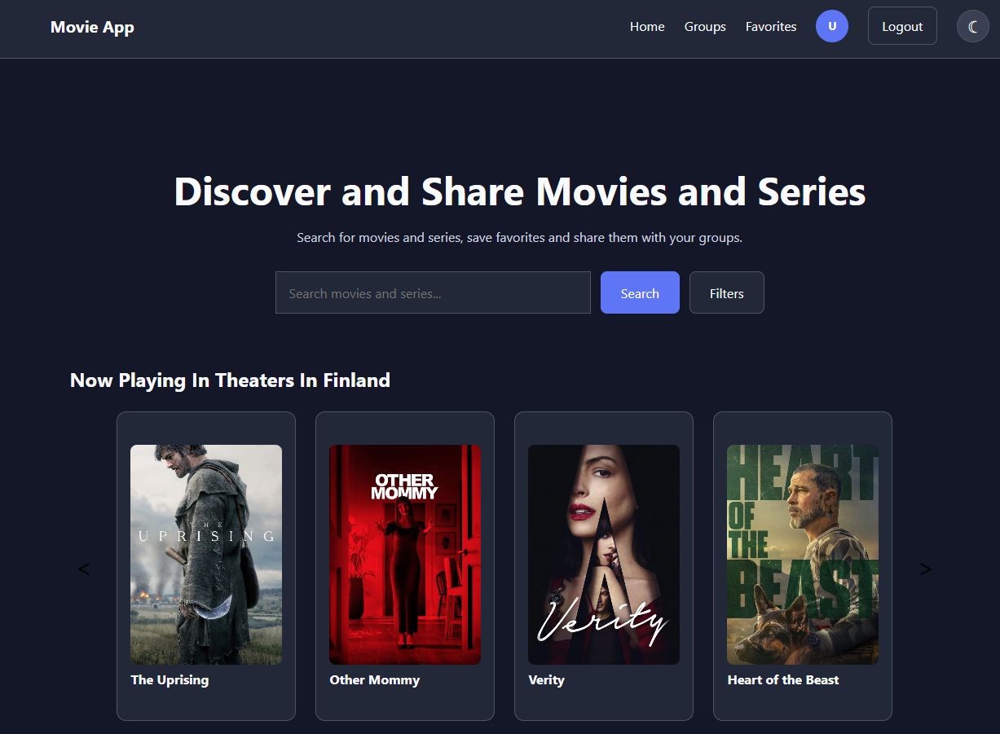
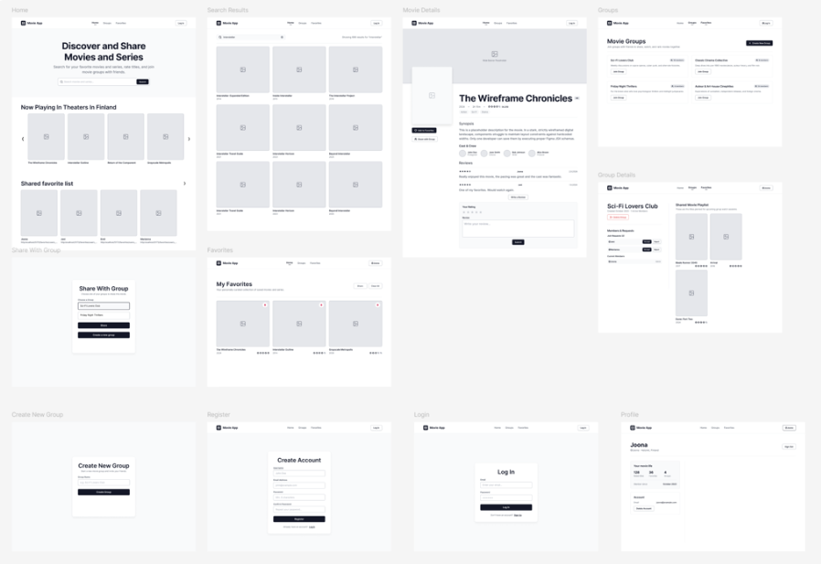

# TVT25KMO Group 7 Movie App

Movie App is a full-stack web application for discovering movies and TV shows, managing favorites, publishing reviews and sharing media with movie groups.

Movie and TV show information is retrieved from TMDB. User accounts, favorites, reviews, groups, memberships and shared group media are stored in PostgreSQL.

This application was developed as a group project by second-year Information and Communications Technology students from Group 7 (TVT25KMO) at Oulu University of Applied Sciences.

## Features

### Public Features

- Browse currently playing movies
- Search and filter movies and TV shows
- Load additional search results
- View movie and TV show details
- Read reviews
- Browse available groups
- Open shared favorite lists
- Switch between light and dark themes

### Authenticated User Features

- Register and log in
- View and manage favorites
- Create a shareable favorites link
- Publish movie and TV show reviews
- Create groups
- Request group membership
- View and share media within joined groups
- Leave a group
- View profile information
- Delete the user account

### Group Owner Features

- View pending membership requests
- Approve or reject membership requests
- View current group members
- Remove members
- Delete the group

## Home Page



## UI Design

The original user interface was designed in Figma and adapted during implementation as the application features developed.




## Presentation

The project presentation is a static website located in the `Presentation/` directory.

Node.js and npm are required to run it locally. Open a terminal in the project root directory and run:

```bash
npx --yes serve Presentation -l 8080
```

Keep the terminal running and open the following address in a web browser:

[http://localhost:8080](http://localhost:8080)

Navigate through the presentation using its on-screen controls or keyboard controls.

To stop the presentation server, return to the terminal and press `Ctrl+C`.

Additional information is available in [Presentation/README.md](Presentation/README.md).

## Technology Stack

| Area | Technology |
| --- | --- |
| Frontend | React and Vite |
| Backend | Node.js HTTP server |
| Database | PostgreSQL |
| Authentication | JWT, refresh tokens and bcrypt |
| External data | TMDB API |
| Containers | Docker and Docker Compose |
| Testing | Jest and Supertest |
| CI/CD | GitHub Actions |
| UI design | Figma |

## Architecture

The frontend communicates with the backend through `/api` routes. TMDB requests are handled by the backend, so the TMDB API token is not exposed to the browser.

The backend follows a routes, services and models structure:

- routes handle URLs, HTTP methods, authentication and responses
- services contain validation and business logic
- models execute parameterized PostgreSQL queries

## Database Model

The application data is stored in PostgreSQL. The database model connects users with favorites, reviews, groups, group memberships and media shared with groups.


## Project Structure

```text
.
├── Backend/
│   ├── auth/
│   ├── helpers/
│   ├── migrations/
│   ├── models/
│   ├── routes/
│   ├── services/
│   ├── tests/
│   ├── app.js
│   └── schema.sql
├── Frontend/
│   └── src/
│       ├── components/
│       ├── context/
│       ├── pages/
│       ├── app.jsx
│       └── styles.css
├── Presentation/
├── .github/workflows/
└── docker-compose.yml
```

## Authentication

The application uses JWT access tokens and refresh tokens.

Access tokens are used to authenticate protected requests. Refresh tokens are stored in HttpOnly cookies and allow the frontend to restore an authenticated session.

Passwords are hashed with bcrypt before they are stored in the database.

## Testing

The backend test suite uses Jest and Supertest.

Automated tests cover areas including:

- registration
- login and logout
- invalid credentials
- authentication errors
- user account deletion
- review creation and retrieval
- duplicate reviews
- request validation

Important application flows have also been verified manually through the user interface.

## Project Team

| Name | Role |
| --- | --- |
| Marianna Taavitsainen | Product Owner and Developer |
| Jani Rekinen | Scrum Master and Developer |
| Emil Koivunen | Developer |
| Joona Louhisalmi | Developer |

The developers shared responsibility for application design, implementation, testing, integration and documentation.